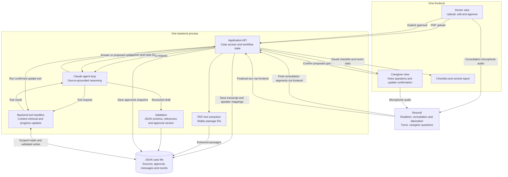

# PlainSpeak four hour MVP team handoff

## Decision and scope

Build a consultation and post-care voice assistant. Capture the doctor-patient conversation live with Reson8, combine it with the discharge document for doctor review, and use the approved context to answer caregiver questions. Preserve what was approved, show evidence for answers and record confirmed caregiver updates for a central report.

This handoff and [the architecture document](PlainSpeak-architecture.md) describe the same current MVP. Use one fictional patient, one text-based discharge PDF, one backend process and one JSON case file. This is a synthetic-data demonstration, not a production clinical application. See [the README](README.md) for setup and running instructions.

### The end-to-end demo

1. Confirm participant consent and record a short fictional clinician-patient consultation using Reson8 Realtime. Final segments save with timestamps and anonymous speaker IDs. End the recording and map each speaker to clinician or patient.
2. Upload the fictional discharge PDF. Claude combines it with the saved consultation, highlights uncertainty and proposes a summary and checklist with source references. Patient beliefs are not treated as clinical instructions.
3. The doctor edits and approves that version. The checklist becomes available in post-care mode.
4. The caregiver asks a question aloud. Reson8 transcribes it.
5. Before the first Claude request, the backend calls `get_case_context` and loads the approved summary, transcript/document evidence snapshot, conversation and progress from JSON. Claude can also call this tool during the interaction.
6. Claude answers with source references, or explains that the supplied material does not establish an answer.
7. The caregiver reports progress. The agent proposes an update; the caregiver confirms it; the backend saves an attributed event.
8. The checklist and central report show the saved update.

### Defer

- Live clinician nudges, automatic medical corrections and raw audio storage. Consultation transcription and speaker mapping are included.
- Simulated patients and instruction stress testing.
- OCR, multiple documents, web research and external email sending.
- Treatment recommendations, symptom monitoring and automatic escalation.
- TTS, notifications, hospital integrations and a vector database.
- Production authentication and deployment with real patient records.

## Architecture



The diagram shows responsibilities, not separate services. Implement all backend boxes in one application. Use HTTP JSON for the MVP; add streaming UI events only if time permits.

Reson8 supplies speech-to-text, not spoken responses. Questions can be captured by microphone; assistant answers appear as text. The browser can connect to Reson8 using a short-lived token issued by the backend. Permanent API keys stay on the backend. Use the actual token endpoint and message format from the official documentation.

## Implemented stack

| Layer | MVP choice |
|---|---|
| Frontend | Static HTML, CSS and JavaScript served by the backend |
| Backend | Python and FastAPI, one process |
| Reasoning | Anthropic Python SDK, one Claude agent loop |
| Speech | Reson8 Realtime with diarization for consultation; Turns for caregiver questions |
| Document input | One text-based PDF, extracted using pypdf |
| Validation | Pydantic contracts and backend reference checks |
| Persistent memory | JSON file per case; no database service |
| Reports | Frontend rendering of saved approved instructions and events |

The current implementation uses this stack. PostgreSQL, a vector database and separate microservices are not needed for this MVP.

## What Claude does and what the backend does

Claude extracts and explains instructions, identifies missing information, asks clarification questions and proposes structured updates. Claude does not directly access the filesystem or independently approve plans.

The backend selects the case, enforces the workflow, executes tools, validates references and writes data. An API call is not completed merely because Claude says it is; the backend must return a successful result.

### Agent tools

| Handler | Input | Backend behavior |
|---|---|---|
| `get_case_context` | `case_id` | Return the approved version, source passages, recent messages, tasks, reported progress and unresolved questions for the permitted case. |
| `propose_progress_update` | `case_id`, `task_id`, `reported_status`, `note` | Validate the task and requested change; store a pending update and return its ID for a user confirmation card. Does not update task status. |
| `record_progress_update` | `case_id`, `pending_update_id`, server-derived actor | Backend-only confirmation handler, not exposed to Claude. Append an event after explicit user confirmation. Reject updates for an older approved version or already resolved proposals. |
| `reject_progress_update` | `case_id`, `pending_update_id` | Backend-only rejection handler. Reject the proposal without changing task status. |

Approval is a separate doctor-view API action. It is not a Claude tool. Similarly, saying “confirmed” in model output is not evidence of user approval.

### Post-care agent loop

1. Receive a finalized caregiver question and case ID.
2. The backend calls `get_case_context` before the first Claude request, ensuring approved context is present even if the model omits a tool call. Claude can also request the tool explicitly.
3. The backend checks the approval state and returns the approved evidence snapshot, including consultation passages, plus relevant messages and events.
4. Claude returns an answer with source IDs, a clarification question, an unresolved question or a proposed progress update.
5. Validate structured output and references before displaying it.
6. Persist the exchange. If an update is proposed, wait for confirmation before changing saved progress.

For a single small case, retrieve the complete approved context; embeddings and vector search are unnecessary.

## Shared output contract

The implementation validates these shapes with Pydantic in `src/plainspeak/contracts.py`. This TypeScript notation documents the HTTP contract; there is no separate TypeScript build:

```ts
type SourceRef = {
  sourceId: string;
  passageId: string;
};

type AgentReply = {
  kind: "answer" | "clarification" | "unresolved" | "update_confirmation";
  text: string;
  sourceRefs: SourceRef[];
  eventRefs: string[];
  pendingUpdateId: string | null;
};

type CareTask = {
  id: string;
  instruction: string;
  timing: string | null;
  responsibleParty: "patient" | "caregiver" | "care_team" | "unspecified";
  sourceRefs: SourceRef[];
};
```

Task status is projected from events for the current approved version, not invented by an answer. `eventRefs` identify saved self-reports; `sourceRefs` identify instruction passages. The checklist is generated with the summary and activated after doctor approval. There is no separate Generate plan button or `save_care_plan` tool.

Example output:

```json
{
  "kind": "answer",
  "text": "The approved instructions say to bring the medication list to the follow-up appointment.",
  "sourceRefs": [
    { "sourceId": "discharge_001", "passageId": "page_1_p4" }
  ],
  "eventRefs": [],
  "pendingUpdateId": null
}
```

## Case storage

```text
data/
  cases/demo-patient.json
  uploads/demo-patient_discharge_001.pdf
```

```json
{
  "caseId": "demo-patient",
  "workflowState": "awaiting_review",
  "sources": [],
  "draftSummary": null,
  "summaryVersions": [],
  "approvedSummaryVersion": null,
  "careTasks": [],
  "messages": [],
  "pendingUpdates": [],
  "progressEvents": [],
  "unresolvedQuestions": [],
  "transcriptSegments": [],
  "speakerRoles": {},
  "inputRevision": 0
}
```

Drafts and approved versions reference `inputRevision`. Each approval saves a `sourcesSnapshot`, preserving the transcript and document evidence reviewed at that time. Segment retries are idempotent; saved segment IDs cannot be silently overwritten. Appending transcript lines, changing speaker mappings or uploading a document invalidates the draft and requires fresh review.

Consultation recording is continuous across pauses and speaker changes. Interim text is displayed only. Ending capture flushes audio and waits for final text and queued saves; unsaved finalized lines remain available for retry while the page stays open. Speaker labels must be explicitly mapped per recording session. Consent is a UI confirmation in this demo, not a production consent record.

Persisted states are `awaiting_review`, `approved` and `post_care_active`. Recording active is frontend state only. Keep post-care questions unavailable while inputs await review. Preserve previous approvals. A doctor edit is applied to the draft before approval; stale input revisions submitted by the frontend are rejected.

Serialize file mutations per case and write via a temporary file followed by replacement. Use server-generated filenames and IDs. Only the backend reads and writes case files. Ignore runtime data and uploads in Git.

## Minimal application API

| Route | Purpose |
|---|---|
| `POST /api/cases` | Create the fictional case. |
| `POST /api/voice/token` | Obtain temporary browser speech credentials. |
| `POST /api/cases/:id/document` | Upload the PDF and extract source passages. |
| `POST /api/cases/:id/transcript` | Save finalized consultation segments or explicit speaker-role mappings; invalidate stale drafts. |
| `POST /api/cases/:id/summary` | Generate the draft summary and source-linked checklist. |
| `POST /api/cases/:id/approve` | Validate and save the doctor-edited approved snapshot. |
| `POST /api/cases/:id/chat` | Save the finalized user message and execute the Claude tool loop. |
| `POST /api/cases/:id/updates/:updateId/confirm` | Record explicit confirmation and execute the update handler. |
| `POST /api/cases/:id/updates/:updateId/reject` | Reject the proposal without changing progress. |
| `GET /api/cases/:id` | Return the case, checklist and report data for the current demo role. |

The report is rendered from saved state and events; it does not need another agent, endpoint or AI-generated report snapshot. It shows approved instructions, self-reported updates with plan version and attribution, current open tasks and unresolved questions. An unresolved question is saved locally, not automatically sent to a doctor.

## Responsibilities and Git workflow

| Owner | Files and work |
|---|---|
| Frontend teammate | `src/plainspeak/static/`: doctor tab, caregiver tab, transcript, source display, checklist, update confirmation and report. |
| Backend teammate | `src/plainspeak/api.py`, `storage.py`, `contracts.py`: transcript persistence, uploads, JSON writes, revision checks, approval and report data. Own integration. |
| AI and speech teammate | `src/plainspeak/ai/`, `voice.py`, `static/consultation.js`: Claude prompts and tools, token flow, continuous consultation capture and caregiver turn handling. Coordinate frontend changes. |
| Optional fourth teammate | Synthetic fixture, expected results, integration checks and demo rehearsal. |

The implementation uses `src/plainspeak/contracts.py` for Pydantic contracts and camelCase JSON over HTTP. Frontend files live in `src/plainspeak/static/`; consultation capture is in `consultation.js`, caregiver UI in `app.js`. Coordinate contract changes before merging. Use short branches and integrate frequently.

## Four hour delivery schedule

| Elapsed time | Required milestone |
|---|---|
| 00:00–00:20 | Freeze fixture, contracts, ownership and environment setup. Check both API credentials. |
| 00:20–01:15 | Frontend works; backend persists a case; Claude returns valid JSON; Reson8 captures both consultation speakers and ends cleanly. |
| 01:15–02:15 | Consultation, document, combined summary, doctor approval and grounded caregiver question work together. |
| 02:15–03:00 | Add confirmed progress updates and the central report. |
| 03:00–03:30 | Verify source references, unknown answers, approval gate and persistence after reload. |
| 03:30–04:00 | Freeze features, fix blockers and rehearse. |

If time slips, preserve consultation transcription and approved-context caregiver answers. Drop report styling and extra checklist features first. Maintain clearly labelled manual transcript and typed-question fallbacks if microphone or network access fails.

## Demo and acceptance checks

The fictional PDF should explicitly state a follow-up date, what to bring and one relevant care instruction. Keep all clinical wording fictional and prepared in advance; do not rely on the model to invent it.

1. Record the clinician-patient conversation, end and save, confirm speaker roles, and upload the document. Doctor reviews and approves the combined plan.
2. Caregiver asks aloud: “What should I arrange before the follow-up?”
3. The agent loads case context and answers from approved passages, showing references.
4. Caregiver says: “Transport is arranged.” The fixture must include transport as a reviewed task if this update is used.
5. An update confirmation appears. No status changes before confirmation.
6. Confirm the update. Reload and verify that the saved event and checklist agree.
7. Ask a question the document does not answer. The agent identifies the gap and records a question for the care team rather than inventing instructions.
8. Open the report: approved instructions, confirmed self-reported update and unresolved question are visible.

The demo-role switch is only a prototype convenience, not access control suitable for real records. No production-readiness or clinical-effectiveness claims.

## Environment variables

The team will provide API keys for both Reson8 and Anthropic. These are the only external API credentials required for this MVP:

| Credential | Used for | Where it is used |
|---|---|---|
| `RESON8_API_KEY` | Obtain short-lived speech credentials for live transcription | Backend only; browser receives a temporary token |
| `ANTHROPIC_API_KEY` | Claude summary extraction, context-grounded answers and tool requests | Backend only |

Use direct API integrations; a Claude consumer subscription is not the integration. No paid OCR, TTS, search, email or hosted database API is required for the agreed scope. Local PDF extraction and JSON storage run in the application. Provider usage charges and account limits still apply.

```dotenv
ANTHROPIC_API_KEY=
ANTHROPIC_MODEL=
RESON8_API_KEY=
PORT=3001
```

Choose a supported Claude model available to the team and set its exact identifier in `ANTHROPIC_MODEL`. Put real values in a Git-ignored `.env`; commit only `.env.example`. Share credentials privately, never in the repository or browser bundle. Do not log tokens, full credentials or uploaded records.

## Official integration references

- [Reson8 Turns](https://docs.reson8.dev/api/speech-to-text/turns/)
- [Reson8 Realtime and diarization](https://docs.reson8.dev/api/speech-to-text/realtime/)
- [Reson8 authentication and browser tokens](https://docs.reson8.dev/authentication/)
- [Claude tool use and backend execution](https://platform.claude.com/docs/en/agents-and-tools/tool-use/overview)

## Definition of done

A teammate can start the app from the README, capture a fictional consultation, confirm speaker roles, combine it with the discharge document for approval, ask a caregiver question, confirm a progress update, reload and view a consistent report. The agent handles an unsupported question without inventing a clinical answer. Automated tests cover backend flows and the simulated browser speech controller; live microphone/provider verification remains a separate demo check.
