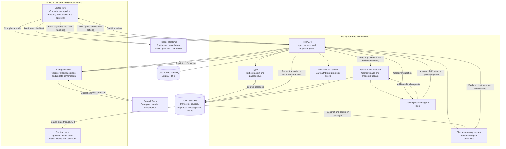
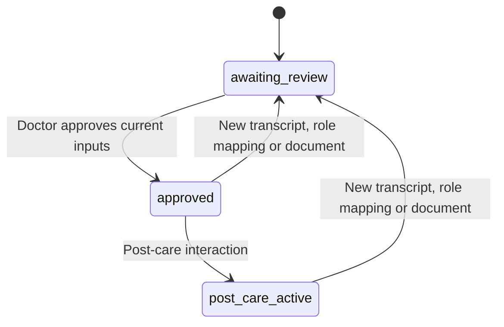

# PlainSpeak MVP architecture

## Scope

PlainSpeak captures a fictional doctor-patient consultation, combines its transcript with a discharge document, and produces a summary and checklist for doctor review. After approval, a caregiver can ask questions by voice, confirm progress updates and view a central report.

This document describes the current implementation. The [team handoff](PlainSpeak-MVP-Team-Handoff.md) covers responsibilities, contracts and the four-hour delivery plan. The [README](README.md) covers setup and running the app.

Use synthetic records only. The demo role switch is not production authentication. This prototype has not been clinically validated.

## System architecture



These are logical responsibilities inside one application, not separate services. The frontend connects to Reson8 with a temporary token issued by the backend. Anthropic and Reson8 permanent API keys remain on the backend. No PostgreSQL, vector database, hosted file service or TTS is required.

## Consultation capture

1. Load the demo case and confirm that both role-players agree to transcription. This is a UI consent confirmation, not a production consent-record system.
2. Choose English, German, or German-and-English detection candidates.
3. Start consultation capture. Reson8 Realtime uses diarization, interim results and timestamps. The session stays open across pauses and speaker changes.
4. Display interim text; persist only finalized segments. Each segment has a stable ID, session ID, anonymous speaker ID, text, recording time and available audio offsets.
5. Select **End and save consultation**. Flush the local audio buffer, request server finalization and wait for finalized text to save before closing.
6. Confirm which anonymous voice is clinician or patient. Speaker identity is not inferred from voice order. A new recording has a separate speaker namespace.
7. If a save fails, keep finalized unsaved lines in browser memory and offer retry. Keep the page open until saved. The manual transcript fallback is explicitly labelled.

The application does not save raw audio. It does not issue live clinical nudges; questions and possible misunderstandings are reviewed in the combined draft.

## Document extraction and doctor approval

Upload a text-based PDF. The backend stores the original locally and extracts page-labelled passages using pypdf. Scanned PDFs requiring OCR are outside scope.

The **Generate draft with Claude** action sends the consultation and document passages together. Consultation passages distinguish clinician, patient and unconfirmed speakers. Patient beliefs are context, not care instructions. Claude is prompted to flag conflicting instructions and missing details for the doctor.

The draft contains `summary`, `careTasks`, `missingInformation`, `sourceIds` and `inputRevision`. The checklist is generated alongside the summary: there is no separate Generate plan button or plan agent tool.

The doctor edits and approves through the application API. Approval saves a versioned summary, tasks, input revision and evidence snapshot. Approval is not available as a Claude tool. The demo does not authenticate a real doctor identity.

New transcript segments, changed speaker roles or a new document invalidate the draft and close post-care mode until review. The frontend submits its input revision when approving; stale revisions are rejected. Previously approved snapshots remain preserved.

## Post-care context and agent tools

For a caregiver question, the backend calls `get_case_context` before the first Claude request. This guarantees that the initial request contains reviewed context even if Claude does not independently request the tool. Claude can call the tool again during its loop.

Context includes the approved summary and tasks, the approved transcript/document evidence snapshot, recent messages, attributed progress events, pending updates and open questions. Approved instructions govern the answer; raw patient statements must not become new directions.

| Handler | Execution | Purpose |
|---|---|---|
| `get_case_context` | Backend preload and Claude-callable tool | Retrieve approved context for the current case. Reject access to a different case or a case awaiting review. |
| `propose_progress_update` | Claude-callable tool | Create a pending update against an approved task; does not change task status. |
| `record_progress_update` | Backend confirmation endpoint only | After a caregiver clicks Confirm, append an attributed event against the current approved version. Reject stale or already resolved updates. |
| `reject_progress_update` | Backend rejection endpoint only | Reject a pending proposal without changing task status. |

An answer carries source-passage or event references. A clarification asks a follow-up question. An unresolved response records the user's question for the care team; it does not contact the care team automatically. Evidence validation checks reference existence, not clinical correctness. Unsupported answers without verifiable evidence are replaced with a clarification message rather than displaying their original text.

## Structured replies and checklist

The HTTP contract uses camelCase. Python Pydantic models use snake_case internally.

```json
{
  "kind": "answer",
  "text": "The approved instructions say to bring the medication list to follow-up.",
  "sourceRefs": [
    { "sourceId": "discharge_001", "passageId": "page_1_p4" }
  ],
  "eventRefs": [],
  "pendingUpdateId": null
}
```

```json
{
  "id": "task_001",
  "instruction": "Bring the medication list to follow-up",
  "timing": "At the follow-up appointment",
  "responsibleParty": "caregiver",
  "sourceRefs": [
    { "sourceId": "discharge_001", "passageId": "page_1_p4" }
  ]
}
```

Tasks do not contain independently writable completion state. The API projects status from saved progress events belonging to the current approved version. A statement such as “transport is arranged” first becomes a proposal. Only explicit confirmation produces an event. Self-reported completion is not evidence of treatment success.

## Persistent memory and workflow state

```text
data/
  cases/demo-patient.json
  uploads/demo-patient_discharge_001.pdf
```

The case file contains transcript segments, speaker-role mappings, extracted sources, input revision, draft summary, approved versions with evidence snapshots, current care tasks, messages, pending updates, progress events and unresolved questions.

Use one backend process. File mutations are serialized per case and written through a temporary file followed by replacement. Transcript segment retries are idempotent; a saved segment ID cannot silently overwrite a previous statement. A vector store is unnecessary for this small context.

Persisted workflow states:



Recording active, connecting and finalizing are frontend session states, not additional persisted case states.

The central report is rendered from approved instructions and saved events. It shows versioned self-reported updates, current open tasks and unresolved questions. There is no separate report-generation tool or stored AI report snapshot.

## Implemented endpoints

| Route | Responsibility |
|---|---|
| `POST /api/cases` | Load/create the fixed demo case; optional explicit reset. |
| `GET /api/cases/{case_id}` | Retrieve the case and projected checklist. |
| `POST /api/voice/token` | Obtain temporary speech credentials and Realtime/Turns URLs. |
| `POST /api/cases/{case_id}/transcript` | Append finalized segments or save speaker mappings. |
| `POST /api/cases/{case_id}/document` | Upload a text PDF and extract passages. |
| `POST /api/cases/{case_id}/summary` | Generate the combined draft summary and checklist. |
| `POST /api/cases/{case_id}/approve` | Save the doctor-edited approved version. |
| `POST /api/cases/{case_id}/chat` | Execute grounded post-care questions and update proposals. |
| `POST /api/cases/{case_id}/updates/{update_id}/confirm` | Confirm a pending progress update. |
| `POST /api/cases/{case_id}/updates/{update_id}/reject` | Reject a pending progress update. |

## Code map

| File | Responsibility |
|---|---|
| `src/plainspeak/static/consultation.js` | Continuous consultation capture, transcript persistence, speaker mapping and recovery. |
| `src/plainspeak/static/app.js` | Doctor review, caregiver Turns capture, confirmation cards and report rendering. |
| `src/plainspeak/api.py` | HTTP endpoints, approval and input revision checks. |
| `src/plainspeak/contracts.py` | Shared schemas, evidence snapshots and version-aware task status. |
| `src/plainspeak/storage.py` | JSON storage and per-case locks. |
| `src/plainspeak/voice.py` | Backend Reson8 token issuance. |
| `src/plainspeak/ai/summary.py` | Combined transcript/document summary drafting. |
| `src/plainspeak/ai/agent.py` | Context preload, tool loop and reply validation. |
| `src/plainspeak/ai/tools.py` | Context and progress handlers. |
| `src/plainspeak/ai/prompts.py` | Source-grounding instructions and output/tool schemas. |

## Verification and remaining live checks

Backend tests cover the combined-source flow, transcript persistence, duplicate retries, speaker mapping, review invalidation, source snapshots, context loading, unsupported-answer replacement and version-aware progress. JavaScript controller tests simulate multi-speaker events, partial results, final flushing and save retry.

These tests use fake provider/browser interfaces. They do not establish live microphone performance, diarization quality or real provider connectivity. Before the demo, test both API credentials and capture a real two-speaker fictional consultation on the browser that will be used.

## Official integration references

- [Reson8 Realtime](https://docs.reson8.dev/api/speech-to-text/realtime/)
- [Reson8 Turns](https://docs.reson8.dev/api/speech-to-text/turns/)
- [Reson8 authentication](https://docs.reson8.dev/authentication/)
- [Claude tool use](https://platform.claude.com/docs/en/agents-and-tools/tool-use/overview)
