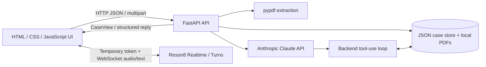

# Technical architecture

## Overview

PlainSpeak is a single-process Python web application. FastAPI serves JSON endpoints and the static frontend; the browser handles UI state and connects directly to Reson8 speech services using a short-lived token. Anthropic credentials remain on the backend. Local JSON files hold case state and local files hold uploaded PDFs. There is no database server, vector database, separate worker, or deployment orchestration requirement.

## Main modules

| Module | Responsibility |
|---|---|
| `main.py` | Creates the FastAPI app, injects the case store and LLM client, mounts static assets, and exposes the `plainspeak` CLI entry point. |
| `api.py` | HTTP routes, upload limits, workflow gates, revision checks, response shaping, and orchestration. |
| `contracts.py` | Pydantic request/response models, enum-like `Literal` constraints, camelCase JSON aliases, case state, source references, and task/event models. |
| `storage.py` | Per-case JSON persistence, per-case locking, ID creation, and atomic file replacement. |
| `pdf_extract.py` | Text extraction, page/passages, stable passage IDs, and best-effort patient-name extraction. No OCR. |
| `transcript_import.py` | Parses speaker-labelled transcript PDF text into normalized segments. |
| `voice.py` | Exchanges the server-side Reson8 API key for a temporary access token. |
| `ai/client.py` | Anthropic SDK adapter, structured-output configuration, provider error normalization, and an injectable `LLM` protocol for tests. |
| `ai/summary.py` | Constructs source-grounded summary and checklist requests and validates model output. |
| `ai/agent.py` | Manual model tool-use loop for post-care questions and structured replies. |
| `ai/tools.py` | Backend implementations for reading approved context and proposing progress updates; confirmation/rejection remain application actions. |
| `ai/prompts.py` | System instructions and output schemas/prompt construction. |
| `static/index.html` | Application layout and three primary views. |
| `static/app.js` | Review/approval, caregiver chat, checklist, progress confirmation, and report interactions. |
| `static/consultation.js` | Continuous capture session, speaker mapping, finalized transcript persistence, and retry/recovery UI. |

## Case lifecycle and revision safety

1. The consultation is captured live, entered manually, or imported from a transcript PDF.
2. A text-based discharge PDF is stored and split into page-labelled passages.
3. Transcript and document passages are sent together to Claude to produce a structured draft summary, care tasks, and missing-information flags.
4. A clinician edits the draft and explicitly approves it. Approval records an immutable version and evidence snapshot.
5. Caregiver Q&A is enabled only when the approved version matches the current input revision.
6. The agent answers from approved context and attaches source/event references. A potential progress update is only a pending proposal.
7. A human confirms or rejects the proposal. Confirmation appends a progress event tied to the plan version; the task checklist is derived from those events.

Any material change to the source inputs invalidates the current draft for approval until a fresh draft is generated. The revision check prevents a stale model output from being approved against newer data.

## Evidence and agent boundaries

The system keeps source references as structured identifiers rather than relying only on free-text citations. A reference identifies a source and passage, which lets the UI and backend trace claims to stored material. This improves inspectability, but a reference alone does not prove that a claim is entailed by the cited text.

The caregiver agent receives only the exposed context-reading and progress-proposal tools. The model cannot approve a plan, confirm a progress update, or directly write a progress event. Those operations are ordinary API actions that require explicit user interaction. Tool handlers also verify the requested case, approved-plan readiness, task membership, and allowed progress status.

## Speech pipeline

- **Consultation** uses Reson8 Realtime speech-to-text with diarization. Interim text is displayed but final segments are persisted. The user maps anonymous speaker IDs to clinician/patient; the app does not infer identity from voice order.
- **Caregiver question** uses Reson8 Turns. A pause can submit the question, and a finish action can submit immediately.
- The permanent Reson8 key is exchanged on the server for a short-lived browser token. Raw audio is not persisted by PlainSpeak.

## Persistence and concurrency

The case store writes one JSON file per case. File mutations are serialized by a per-case lock and persisted via a temporary file followed by replacement to reduce partial-write risk. Transcript IDs support idempotent retries. Original uploads are kept separately under the configured data directory. This storage strategy is suitable for a local demonstration, not multi-instance production deployment, high write volume, or regulated audit requirements.

## Failure and recovery

- Missing/invalid provider credentials are normalized into application errors.
- Transcript save failures leave unsaved finalized segments in browser memory with a retry path; keep the tab open until recovery succeeds.
- Stale drafts are blocked from approval by input revision checks.
- Duplicate segment IDs do not silently overwrite earlier text.
- Unsupported/uncited answers are subject to response validation and may be converted to a clarification.
- PDF extraction errors are surfaced; scanned PDFs requiring OCR are out of scope.

## Design trade-offs

The MVP favors explainability and inspectable state over infrastructure. Local JSON makes a hackathon demo easy to run and audit, but lacks database transactions, multi-user isolation, migrations, backups, and distributed locking. The small evidence set is passed directly to the model, so a vector index is not needed for the demo. Human approval and explicit confirmation are deliberately outside the model's tool permissions.
