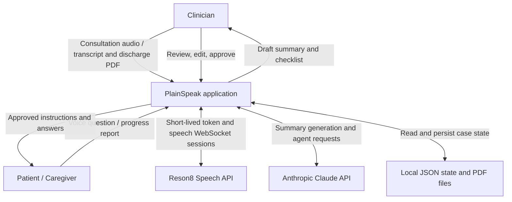
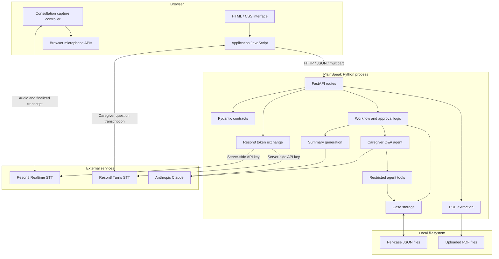
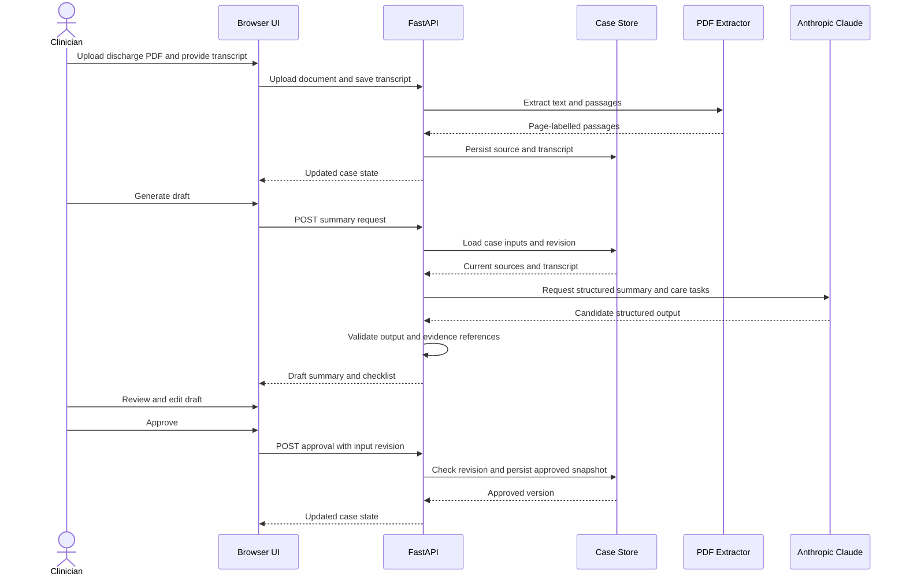
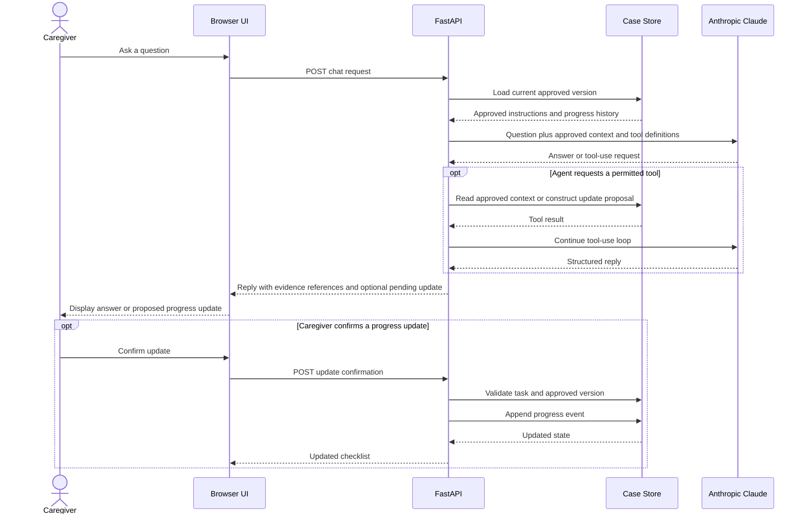
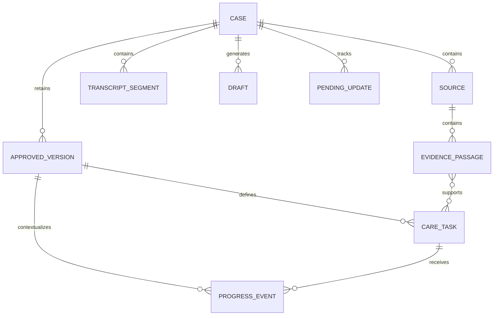

# PlainSpeak: System Architecture and Design Notes

## 1. Purpose and scope

PlainSpeak is an AI-assisted post-discharge communication prototype. It converts a clinician-patient consultation and a discharge document into a draft plain-language summary and actionable care checklist. After clinician review and approval, a caregiver can ask questions about the approved instructions and report progress against the checklist.

The architecture is designed around four principles:

1. **Human approval before use:** AI-generated care instructions remain drafts until explicitly reviewed and approved by a clinician.
2. **Evidence traceability:** Summaries, care tasks, and answers should refer back to source documents or recorded consultation evidence.
3. **Controlled state changes:** A model can propose a progress update, but the application requires explicit confirmation before recording it.
4. **Reproducibility:** The prototype can run locally with synthetic data, without requiring a database server or a frontend build pipeline.

This is a hackathon prototype, not a clinically validated system. All demonstration data should be synthetic.

## 2. System context

The system has three primary external actors:

- **Clinician:** supplies consultation and discharge information, reviews the generated draft, edits it, and approves the final instructions.
- **Patient or caregiver:** views approved instructions, asks questions, and reports whether a care task has been completed.
- **External AI and speech services:** Anthropic Claude generates structured text and handles tool-assisted Q&A; Reson8 provides speech transcription and speaker diarization.

### Context diagram



### System boundary

PlainSpeak owns the workflow state, approval gates, evidence references, local file persistence, and progress-confirmation process. Reson8 owns speech recognition services. Anthropic owns the hosted model inference.

The browser communicates with the PlainSpeak backend over HTTP and connects to Reson8 using a temporary access token. The backend communicates with Anthropic using its server-side API credentials.

The prototype does not include a hospital information system integration, electronic health record connection, production identity provider, or clinical database.

## 3. Technology and deployment architecture

The application is a single-process Python web service with a static browser frontend.



The diagram represents logical responsibilities, not a deployment across independent microservices. The Python components execute in the same process. The speech provider endpoints are external services accessed by the browser using a temporary token.

## 4. Backend component responsibilities

| Component | Responsibility |
|---|---|
| `main.py` | Application initialization, dependency construction, static file mounting, and CLI entry point. |
| `api.py` | HTTP endpoints, request handling, workflow orchestration, revision checks, and response construction. |
| `contracts.py` | Typed data contracts, input validation, and structured domain models. |
| `config.py` | Environment-based configuration and secret loading. |
| `storage.py` | Local case persistence, per-case synchronization, and file replacement. |
| `pdf_extract.py` | PDF text extraction and page-level evidence passages. |
| `transcript_import.py` | Parsing uploaded, speaker-labelled transcript PDFs. |
| `voice.py` | Server-side exchange of the permanent Reson8 API key for a short-lived token. |
| `ai/client.py` | Anthropic SDK integration and the common model-client interface. |
| `ai/summary.py` | Construction and validation of structured summary-generation requests. |
| `ai/agent.py` | Caregiver Q&A orchestration and the model tool-use loop. |
| `ai/tools.py` | Restricted backend tools for retrieving approved information and proposing progress updates. |
| `ai/prompts.py` | System instructions and model prompt construction. |
| `static/index.html` | Browser interface structure. |
| `static/app.js` | Approval, checklist, caregiver chat, and progress-update interactions. |
| `static/consultation.js` | Consultation speech capture, speaker mapping, finalized transcript persistence, and recovery behavior. |

## 5. Core application workflow

### Stage A: Capture and ingest

The consultation may be captured through the browser's microphone using Reson8 Realtime transcription, entered as text, or imported from a supported transcript PDF.

The discharge document is uploaded as a PDF. The backend extracts selectable text, divides it into page-labelled passages, and stores source references.

Scanned PDFs requiring optical character recognition are outside the current implementation.

### Stage B: Generate a draft

The backend combines consultation segments and discharge-document passages into a request to Anthropic Claude.

The model returns structured output containing a plain-language summary, proposed care tasks, and relevant missing-information indicators. The backend validates the result against the expected schema before returning it to the frontend.

The output is not treated as authoritative medical advice. It remains a draft requiring review.

### Stage C: Clinician review and approval

The clinician can inspect and edit the generated content before approval.

Approval creates a versioned snapshot of the summary, care tasks, and associated evidence. The snapshot records which input revision was used to produce the approved instructions.

A stale draft must not be approved against changed source inputs. The backend checks revision consistency when processing approval.

### Stage D: Caregiver question answering

The caregiver asks a question by typing or using Reson8 Turns transcription.

The backend checks that the case has a valid, current approved version. It then constructs an agent request using approved context and a restricted set of available tools.

The agent can answer from the available evidence, request clarification, or indicate that the information is unresolved. Responses can include references to supporting source passages or prior progress events.

### Stage E: Progress reporting

A caregiver may report that a task has been completed. The model can propose a structured update, but this proposal is not immediately persisted as a completed task.

The user explicitly confirms or rejects the proposal. Confirmation creates an attributed progress event associated with the approved plan version. The checklist status is derived from recorded progress events.

This separates natural-language interpretation from consequential state mutation.

## 6. Sequence diagram: summary generation and approval



## 7. Sequence diagram: caregiver Q&A and progress update



## 8. Data model and persistence

The primary aggregate is a case. A case contains source documents, transcript segments, current input revision, generated drafts, approved versions, pending updates, and progress events.

### Conceptual entity relationships



This diagram is conceptual. It does not imply that the JSON store implements relational database constraints.

### Important domain concepts

- **Case:** the container for one demonstration workflow.
- **Source:** an uploaded document or consultation source with stable identifiers.
- **Evidence passage:** a page- or segment-level unit that can be referenced by generated content.
- **Transcript segment:** finalized consultation text, with speaker identifier and timing metadata when available.
- **Draft:** model-generated candidate content that is editable and not yet approved.
- **Approved version:** an immutable snapshot of the reviewed summary, tasks, and evidence state.
- **Care task:** an instruction with a responsible party, optional timing, and evidence references.
- **Pending update:** a proposed state change awaiting explicit confirmation.
- **Progress event:** a confirmed event linked to a task and approved version.

### Persistence design

The prototype stores case state in JSON files and uploaded PDFs in a local directory. Mutations are serialized using per-case locks, and file replacement uses a temporary-file strategy to reduce the risk of partially written state.

This approach is intentionally simple for a local hackathon demonstration. It is not a substitute for a transactional database, access-controlled object storage, durable backups, or a regulated audit log.

## 9. Trust boundaries and security design

### Boundary 1: Browser to backend

The browser sends requests to FastAPI. The backend validates structured inputs and is responsible for enforcing approval and workflow rules.

There is no production authentication or verified user identity. The `approvedBy` field is a supplied label, not an authenticated identity. The application must not be exposed publicly with real patient information.

### Boundary 2: Browser to Reson8

The backend exchanges the permanent Reson8 API key for a short-lived token. The browser uses this temporary token to establish speech sessions.

The permanent key must not be embedded in JavaScript, committed to source control, or returned from a backend endpoint.

### Boundary 3: Backend to Anthropic

The backend sends prompts, source passages, and caregiver questions to the hosted model. This is an external data-processing boundary. Only synthetic demonstration data should be used until appropriate privacy, contractual, and security controls have been established.

### Boundary 4: Model output to application state

Model output is untrusted input. It must be validated and cannot directly authorize plan approval or completion events.

The application retains control over consequential transitions, including approval, confirmation, and rejection.

## 10. Architectural decisions and rationale

| Decision | Rationale | Trade-off |
|---|---|---|
| FastAPI monolith | Simple local setup, clear routing, automatic OpenAPI generation, and straightforward dependency injection. | Limited horizontal scalability without additional infrastructure. |
| Static HTML, CSS, and JavaScript | No frontend build system or package installation is needed. | Less structure than a large component-based frontend. |
| Reson8 for speech | Separates speech recognition from the application's clinical workflow and provides realtime and turn-based transcription paths. | Depends on external service availability, credentials, and network access. |
| Anthropic for language generation | Supports structured output and tool-assisted question answering. | Requires provider access and external processing of supplied text. |
| JSON file persistence | Easy to inspect and reproduce in a demo. | Limited concurrency, transactions, access control, and recovery guarantees. |
| Evidence references | Makes source tracing and jury inspection easier. | Reference existence alone does not prove factual correctness or entailment. |
| Explicit clinician approval | Prevents a generated draft from automatically becoming the active care plan. | Adds a deliberate human review step. |
| Explicit progress confirmation | Separates a model interpretation from an accepted state change. | Requires a user action before progress is recorded. |
| Revision checks | Helps prevent approving drafts produced from stale inputs. | Requires careful maintenance of revision increments across all input mutations. |

## 11. Failure modes and recovery

| Failure | Expected handling |
|---|---|
| Missing provider credentials | Provider-dependent functionality fails with a clear configuration error; local tests should use a fake LLM. |
| Reson8 token exchange fails | Voice functionality cannot start. Text entry or other supported input paths may still be available. |
| Speech session disconnects | Unsaved finalized transcript segments should remain available for retry while the browser tab is open. |
| Invalid or unsupported PDF | Reject the upload or surface extraction failure. Scanned PDFs are not supported without OCR. |
| Model returns malformed structured output | Reject or normalize the output according to the validation path; do not treat invalid output as an approved plan. |
| Inputs change after draft generation | Revision checks prevent stale draft approval. Generate a fresh draft. |
| Caregiver question is unsupported | Return a clarification or unresolved response instead of inventing an instruction. |
| Proposed update is rejected | Do not append a completion event or change the checklist status. |
| Local storage becomes unavailable | Persistence operations fail; the prototype has no distributed recovery service or managed backup. |

## 12. Testing and verification

The repository includes Python tests and Node-based frontend controller tests. Use:

```bash
uv sync
uv run python scripts/make_fixture.py
uv run pytest
node --test tests/consultation_frontend.test.cjs
uv run ruff check .
```

These tests do not replace manual testing with a microphone and valid Reson8 credentials. Before a demo, verify the complete workflow:

1. Start the server and open the local URL.
2. Upload a synthetic discharge PDF and provide a transcript.
3. Generate, edit, and approve a summary.
4. Ask a caregiver question and inspect the evidence references.
5. Propose a progress update and reject it; verify that status does not change.
6. Propose another update and confirm it; verify that the checklist reflects the event.
7. Change an input and verify that stale approval is prevented.

## 13. Future architecture improvements

For a production-oriented successor, the following changes should be considered:

- Replace JSON persistence with a transactional database and schema migrations.
- Introduce authenticated clinician and caregiver identities, authorization, and per-patient isolation.
- Use managed encrypted object storage for uploaded files.
- Add audit logs, retention and deletion workflows, backup and recovery procedures.
- Add monitoring, rate limits, observability, and provider-failure handling.
- Evaluate evidence entailment, hallucination rates, usability, accessibility, and clinical safety with an appropriate review process.
- Add OCR only with an explicit document-quality and extraction-validation strategy.
- Introduce a retrieval index only if the scale of the evidence corpus warrants it.
- Assess applicable privacy and medical-device requirements before real-world deployment.

## 14. Source of truth

The source code is authoritative when behavior differs from this document. Key implementation files include `src/plainspeak/api.py`, `src/plainspeak/contracts.py`, `src/plainspeak/storage.py`, `src/plainspeak/voice.py`, and the modules under `src/plainspeak/ai/`.

Update these notes whenever the implementation or external service contracts change.
